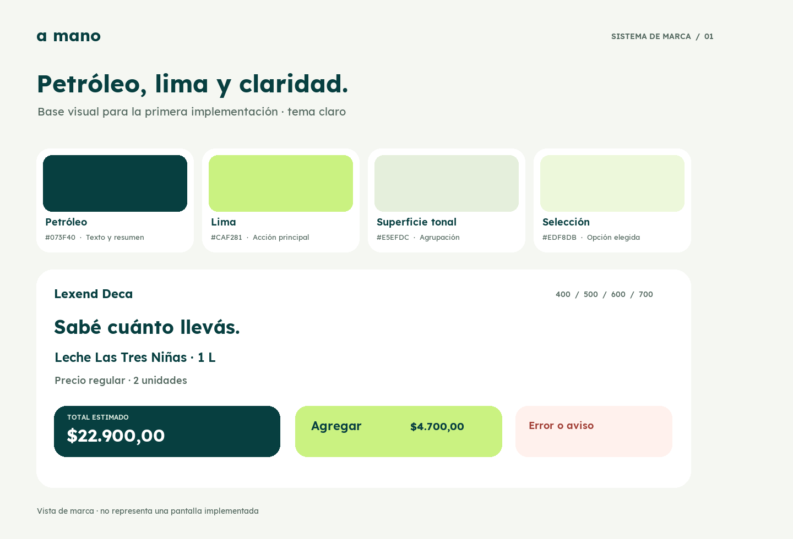

# Sistema de marca · primera implementación

Fecha: 26 de septiembre de 2026. Estado: **base elegida para implementar y probar**.

La dirección del [recorrido visual 02](v2/README.md) pasa a ser la referencia
de color y tipografía de la app. La elección fija una base de trabajo, no
declara que la interfaz haya sido validada en un teléfono o con compradores.
«a mano» continúa como nombre provisional. El tema oscuro y la identidad
gráfica de ícono, logo y splash se definirán después.

La lámina muestra colores y tipografía reales; no representa una pantalla
implementada ni verifica el aspecto en un teléfono.

## Paleta clara

Los nombres expresan función. Una superficie seleccionada siempre agrega
borde y marca visible; el color por sí solo no comunica el estado.

| Token | Valor | Uso |
| --- | --- | --- |
| `ink` | `#073F40` | Texto principal, acciones oscuras y resumen de compra |
| `accent` | `#CAF281` | Acción principal de captura o agregado, con texto `ink` |
| `canvas` | `#F5F7F2` | Fondo de pantallas claras |
| `surface` | `#FFFFFF` | Filas, campos y superficies elevadas |
| `surfaceTonal` | `#E5EFDC` | Resumen claro y acciones secundarias |
| `textSecondary` | `#53685F` | Condiciones, unidades y contexto sobre fondos claros |
| `selection` | `#EDF8DB` | Fondo de una opción elegida |
| `selectionBorder` | `#66844F` | Borde de opción elegida, acompañado por una marca |
| `border` | `#C6D6C9` | Divisiones y contornos decorativos; no usar como único indicador de estado |
| `onInk` | `#FFFFFF` | Texto principal sobre `ink` |
| `onInkSecondary` | `#DCE9DF` | Texto de apoyo sobre `ink` |
| `danger` | `#A13E35` | Errores y acciones destructivas explícitas |
| `dangerSurface` | `#FFF1ED` | Fondo de error con texto `danger` |

El lima identifica la acción principal, no un precio menor ni un ahorro.
Las superficies tonales agrupan información sin convertir cada bloque en un
botón. Sobre la cámara real se debe resolver el contraste de superposiciones
según el encuadre; estos colores sólidos no lo garantizan.

## Tipografía

Lexend Deca es la única familia de interfaz. Se incluyen archivos TTF
estáticos de pesos 400, 500, 600 y 700 en [`assets/fonts`](../../../assets/fonts/)
y su [licencia OFL](../../../assets/fonts/OFL.txt). Provienen del
[repositorio de Lexend](https://github.com/googlefonts/lexend/tree/20491885ca2cf7ffc556432973e7bdbc701952b5/fonts/deca/ttf).
La lámina usó la versión variable; estos pesos estáticos conservan su intención
y evitan depender del soporte nativo de fuentes variables en Expo SDK 57.

| Rol | Tamaño / interlínea | Peso | Aplicación |
| --- | --- | --- | --- |
| Total destacado | 32 / 38 | 700 | Acumulado visible durante la compra |
| Título de pantalla | 22 / 28 | 700 | Orientación principal |
| Título de sección | 20 / 26 | 600 | Grupos dentro de una pantalla |
| Nombre de producto | 16 / 23 | 600 | Identificación en confirmación y lista |
| Acción principal | 17 / 23 | 600 | Botones de captura, agregado y cierre |
| Texto habitual | 15 / 22 | 400 | Explicaciones breves y datos |
| Texto secundario | 14 / 20 | 500 | Condición de precio, unidad y contexto |
| Rótulo auxiliar | 12 / 17 | 500 | Etiquetas breves no indispensables |

No reducir la fuente para forzar nombres, importes o condiciones a una sola
línea. Los importes usan cifras tabulares cuando el componente las admite.
El texto auxiliar no debe contener información indispensable por sí solo.

## Contraste comprobado

Ratios calculados sobre colores sólidos sRGB: `ink`/`accent` 9,21:1;
`ink`/`surface` 11,71:1; `textSecondary`/`canvas` 5,54:1;
`textSecondary`/`surfaceTonal` 5,04:1; `textSecondary`/`selection`
5,42:1; `danger`/`dangerSurface` 5,85:1. `selectionBorder`/`selection`
alcanza 3,83:1. `border` es decorativo y tiene sólo 1,51:1 sobre blanco.

Estos pares no sustituyen una revisión de todos los estados. Los tokens ya se
aplican a la interfaz actual. Fuente, tamaño de texto, foco, controles
deshabilitados y contraste sobre cámara real requieren comprobación en un
teléfono. El tema claro será explícito hasta diseñar el oscuro.
