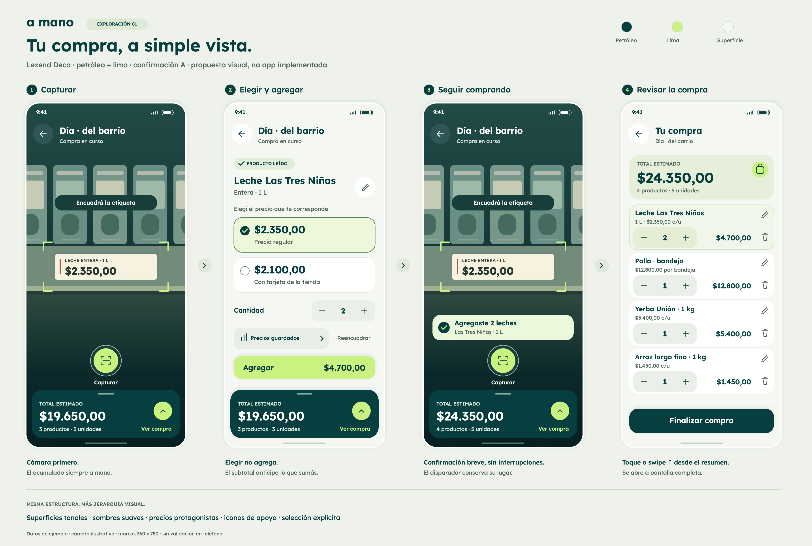

# Dirección visual 01 · Lexend Deca

Antecedente visual. El [recorrido 02](../v2/README.md) es la lámina vigente e
incorpora apartados y finalización, sin los lápices ni la papelera de esta versión.

Fecha: 24 de septiembre de 2026.
Estado: **rumbo visual aceptado provisionalmente; no es una aprobación definitiva
ni una prueba de usabilidad**. El usuario indicó que mejoró bastante y quiere
continuar por este camino, aunque aún no lo convence del todo. Esto no ratifica
automáticamente cada componente o detalle de interacción propuesto.
No se modificó el código de la aplicación.

**Decisiones posteriores (26/09):** la edición de nombre/precio se pospuso y
la papelera del carrito se reemplaza conceptualmente por apartar/reincorporar
sin ocultar el producto. Este PNG aún no representa esos cambios. Consultar
[Compra actual](../../pantallas/04-compra-actual.md) y
[Confirmación](../../pantallas/03-confirmacion.md) para la decisión vigente.

Una sola lámina PNG de 3680 × 2480 píxeles, sin exportaciones individuales ni
duplicados SVG. Desarrolla el [wireflow anterior](../../wireflows/v1/README.md)
y conserva la confirmación A elegida. Los marcos usan 360 × 780 unidades de
composición; no son una medición del Xiaomi Mi 9T. El aumento respecto de las
760 unidades del wireframe es una propuesta de espaciado, no un nuevo requisito
de pantalla mínima. La adaptación a pantallas más cortas sigue pendiente.

## Qué tomamos de la referencia del usuario

- Superficies de distintos tonos para agrupar información, no una sucesión de
  botones idénticos.
- Verde petróleo, acentos lima, fondos claros y sombras suaves.
- Variación de peso tipográfico entre precio, producto y contexto.
- Iconos discretos y formas redondeadas para expresar acciones y estados.

No se trasladan catálogo, delivery, categorías ni navegación de la app de
referencia: resuelven otro contexto de uso. Su barra flotante inspira separación
y elevación de superficies; no justifica agregar pestañas durante una captura.
La navegación global sigue pendiente del diseño de Inicio y las otras áreas.
Esta referencia aporta una preferencia estética del fundador, no evidencia de
mercado ni resultados de investigación con usuarios.

## Sistema visual propuesto

| Recurso | Valor utilizado | Rol y fundamento |
| --- | --- | --- |
| Tipografía | Lexend Deca variable | Prueba solicitada explícitamente por el usuario; carácter cercano y diferencias de peso sin cambiar de familia |
| Texto habitual | Pesos 400–500 | Contexto, presentación y condiciones; no tratar cada texto como un título |
| Nombres e importes | Pesos 550–650 | Hacer reconocible el producto y facilitar localizar el importe |
| Petróleo | `#073F40` | Texto principal, resumen persistente y cierre de compra |
| Lima | `#CAF281` | Capturar, Agregar e indicación de acceso a compra; no significa automáticamente «más barato» |
| Fondo claro | `#F5F7F2` | Separar el resultado y la revisión del contexto visual de la cámara |
| Texto secundario | `#53685F` | Condiciones y contexto con contraste suficiente sobre las superficies propuestas |
| Selección | Fondo `#EDF8DB`, borde y marca | La elección se reconoce por más de una señal; no depende sólo del color |
| Elevación | Sombra suave en resumen y acciones principales | Distinguir capas y zonas de acción sin añadir sombra a cada elemento |
| Esquinas | 14–25 unidades en superficies | Agrupación amable y consistente; los radios exactos no quedan cerrados |

En las pantallas: títulos de 20–22, importes de 24–32, nombres de lista de 15,
acciones de 17–19 y textos secundarios de 12–14 unidades. Los rótulos breves de
estado usan 10–11; requieren revisión de legibilidad. No reducir estos tamaños
para acomodar contenido largo: prever crecimiento, desplazamiento y texto
ampliado. Todavía no se evaluó la tipografía bajo iluminación de supermercado.

Se usó el archivo real `LexendDeca[wght].ttf` de
[Google Fonts](https://github.com/google/fonts/tree/main/ofl/lexenddeca), con
registro temporal en el proceso de dibujo; se verificó la familia y su eje
de peso 100–900. No se instaló globalmente ni se incorporó una dependencia a la
app. La fuente se distribuye bajo
[SIL Open Font License 1.1](https://github.com/google/fonts/blob/main/ofl/lexenddeca/OFL.txt).
Si se incorpora a la app, distribuir también su licencia. El PNG contiene
texto rasterizado, no el archivo de fuente.

## Rol de cada pantalla

### 01 · Capturar

La cámara ocupa la mayor parte de la superficie. Una cabecera compacta sitúa
la compra; la guía y el disparador lima concentran la tarea. El resumen oscuro
permanece abajo con importe, cantidad y acceso explícito «Ver compra».

La góndola está dibujada deliberadamente como ilustración: no representa una
foto, un filtro que aplicar a la cámara ni una lectura OCR real. En la app la
imagen será la cámara sin esa estilización. Será necesario probar contraste
de las superposiciones sobre imágenes reales, claras y oscuras.

### 02 · Elegir y agregar

Se conserva A: producto reconocible arriba, precios en filas y confirmación
separada. La opción elegida usa fondo tonal, borde y marca; la otra sigue siendo
legible. La lámina muestra **una elección ya hecha**, no una preselección entre
varios precios. Con varios candidatos, el estado inicial continúa sin elección.

Cantidad queda junto a las opciones. Precios guardados y Reencuadrar comparten
una fila secundaria, con espacios separados; Agregar tiene una superficie lima
propia y muestra $4.700,00 de subtotal. El resumen mantiene $19.650,00 hasta
confirmar: son dos importes con roles distintos, a comprobar en pruebas.

El lápiz junto al producto propone corrección de ese dato, no implica que los
precios no puedan corregirse. El acceso y superficie para corregir importes,
incluido el ajuste de promociones, siguen pendientes; no se presentan como
resueltos por esta lámina.

### 03 · Seguir comprando

Vuelven el encuadre y el disparador a sus posiciones originales. El aviso
«Agregaste 2 leches» confirma la operación y el resumen pasa a $24.350,00. No se
abre el carrito automáticamente. Duración, anuncio accesible y tratamiento de
fallos siguen pendientes; la lámina no simula una animación ni una respuesta real.

### 04 · Revisar la compra

El total usa una superficie clara con tinte para diferenciarlo de las filas.
Cada producto agrupa nombre, precio unitario, cantidad y subtotal. El último
agregado aparece primero y con tinte suave: ambas decisiones siguen propuestas.
El resaltado debe dejar de competir con la selección de precios al cambiar de
contexto; no significa «producto más barato» ni «necesario».

Editar y quitar son iconos de apoyo. Sus futuras áreas táctiles deben reservar
48 × 48 unidades sin solaparse; el dibujo del icono no es su área de toque.
La cantidad reserva tres zonas de 48 × 48. Finalizar está separado abajo.
El cierre y el ticket opcional no se diseñan todavía en esta lámina.

Tocar o deslizar el resumen abre esta pantalla completa con transición ascendente.
La manija y el chevron del resumen no agregan un estado de bottom sheet. Atrás
regresa al encuadre. La revisión también es accesible antes del próximo escaneo;
pasar de 03 a 04 es opcional, no un paso obligatorio de cada producto.

## Registro transversal

| ID | Estado | Decisión o propuesta |
| --- | --- | --- |
| VIS-01 | Acordado provisionalmente | Continuar con Lexend Deca dentro de esta dirección; la elección definitiva sigue abierta |
| VIS-02 | Preferencia expresada | Superficies tonales, pesos variados, iconos y elevación como en la referencia compartida |
| VIS-03 | Acordado como rumbo provisional | Continuar con petróleo, lima y fondos claros; el usuario aclara que el resultado aún no lo convence del todo |
| VIS-04 | Acordado | Desarrollar confirmación A, sin reabrir la comparación A/B |
| VIS-05 | Propuesto | Mantener las pestañas globales fuera del recorrido activo mientras se diseña su arquitectura |

Los detalles de cada pantalla se registran también en
[Captura](../../pantallas/02-captura.md),
[Confirmación](../../pantallas/03-confirmacion.md) y
[Compra actual](../../pantallas/04-compra-actual.md).

## Qué se comprobó y qué no

- PNG inspeccionado visualmente y corregido: separación de Reencuadrar respecto
  de Agregar/resumen, legibilidad de nombres y contraste de textos secundarios.
- Aritmética del ejemplo: 12.800 + 5.400 + 1.450 = 19.650; 2 × 2.350 = 4.700;
  total posterior 24.350, con 4 productos y 5 unidades. Datos ficticios, no precios
  vigentes. Las condiciones de los candidatos también son ilustrativas.
- Contraste calculado a partir de colores sólidos sRGB: petróleo/lima 9,21:1;
  blanco/petróleo 11,71:1; secundario/fondo base 5,54:1;
  secundario/selección 5,42:1; secundario/tarjeta del total 5,03:1.
  Son pares revisados, no una auditoría completa de accesibilidad. No verifican
  cámara real, antialiasing, estados deshabilitados ni texto ampliado.
- No se ejecutaron pruebas automáticas de la app ni se generaron bundles:
  sólo documentación y un PNG. No hubo revisión de app en navegador, ejecución
  en teléfono físico ni pruebas con participantes.

## Continuidad

Conservar esta dirección como base de trabajo, sin cerrar todavía su acabado.
La [continuación propuesta](../../pantallas/README.md#continuación-propuesta)
prioriza completar las interacciones de compra antes de ampliar el alcance.
En la siguiente revisión visual, precisar qué no convence —densidad, formas,
color, tipografía o protagonismo del resumen— sin inferirlo del comentario
general. Preferencia estética y facilidad de uso se evaluarán por separado.
