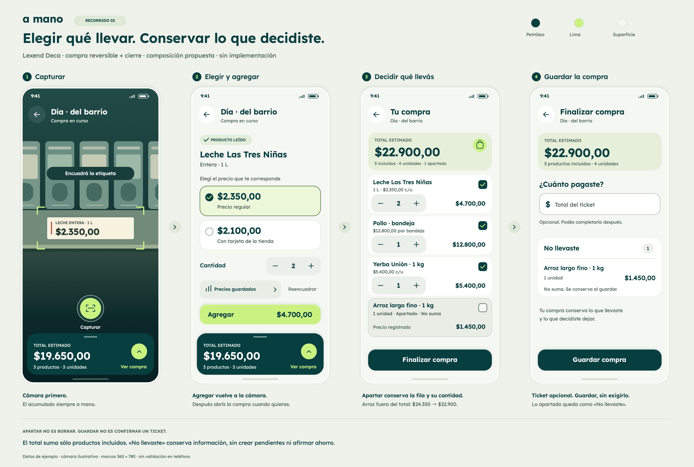

# Recorrido visual 02 · Apartar y finalizar

Fecha: 26 de septiembre de 2026.
Estado: decisiones de inclusión y conservación acordadas; controles y composición
propuestos. Mantiene la dirección visual provisional de Lexend Deca, petróleo
y lima. Sin cambios de código de la aplicación.

Una lámina PNG de 3680 × 2480; sin SVG ni pantallas sueltas. La
[versión 01](../v1/README.md) queda como antecedente de estilo, no como guía
vigente de edición o retiro. Su sistema tipográfico, fuente real y procedencia
se mantienen. Los marcos siguen en 360 × 780 unidades de composición.

## Lectura del recorrido

1. **Capturar:** cámara y acumulado, sin cambios de estructura.
2. **Confirmar:** composición A; se retira el lápiz porque el editor de
   nombre/precio fue pospuesto. Dos leches a $2.350 sumarán $4.700. El acumulado
   previo aún es $19.650; seleccionar no agrega.
3. **Compra actual:** después de agregar se vuelve a la cámara, no al carrito.
   La lámina omite ese estado repetido. La persona abre la compra por toque o
   swipe y aparta el arroz: $24.350 pasa a $22.900. La fila queda visible en su
   lugar, con cantidad y precio; al reincorporarla volvería a sumar.
4. **Finalizar:** total estimado de incluidos, ticket opcional y «No llevaste».
   Guardar conservará ambos grupos, sin sumar los apartados al gasto. La lámina
   muestra el cierre antes de guardar, no un éxito de persistencia simulado.

La casilla de inclusión es una propuesta, no un componente aprobado por el
usuario. Aparta todas las unidades del producto y tiene que ofrecer un área
táctil de al menos 48 × 48 y un nombre accesible que explique su acción y estado.
En el dibujo mide 22 × 22; el tamaño del icono no es el del objetivo táctil.
No se cambia de lugar la fila al apartarla. Precio y cantidad continúan legibles.

En el cierre «No llevaste» usa un grupo separado: el usuario ya terminó de
decidir, a diferencia del carrito activo. Su valor es conservar información,
no inferir motivación ni crear una lista de próximas compras automáticamente.
Para muchos apartados, la composición y expansión se precisan en
[Finalización](../../pantallas/05-finalizacion.md).

## Documentación por pantalla

- [Captura](../../pantallas/02-captura.md).
- [Confirmación](../../pantallas/03-confirmacion.md).
- [Compra actual](../../pantallas/04-compra-actual.md).
- [Finalización](../../pantallas/05-finalizacion.md).

## Comprobaciones y límites

- PNG inspeccionado visualmente: textos, separación de controles, estado de arroz
  apartado y campo de ticket vacío. Se corrigió un texto que podía sugerir que
  los datos ya se habían guardado antes de tocar Guardar.
- Cálculos en centavos: 1.965.000 + 470.000 − 145.000 = 2.290.000. Tres productos
  incluidos, cuatro unidades incluidas y un producto apartado de una unidad.
- Nombre de fuente verificado al renderizar: Lexend Deca. Misma paleta de v1;
  no se declara una auditoría completa de accesibilidad.
- Todos los precios, local y etiqueta son ejemplos. Cámara ilustrativa, no OCR
  real. No se presentan pantallas implementadas ni resultados con participantes.
- Sólo documentación y PNG: sin pruebas de app, bundles, revisión web ni
  ejecución en teléfono. Faltan gestos, teclado, texto ampliado y listas largas.
