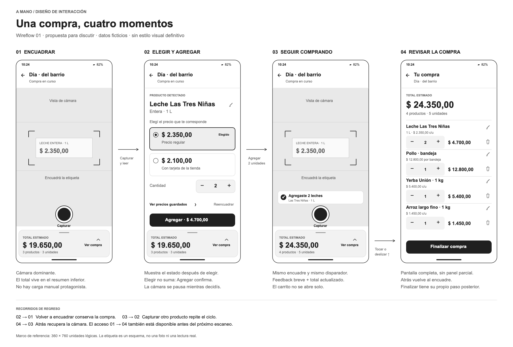
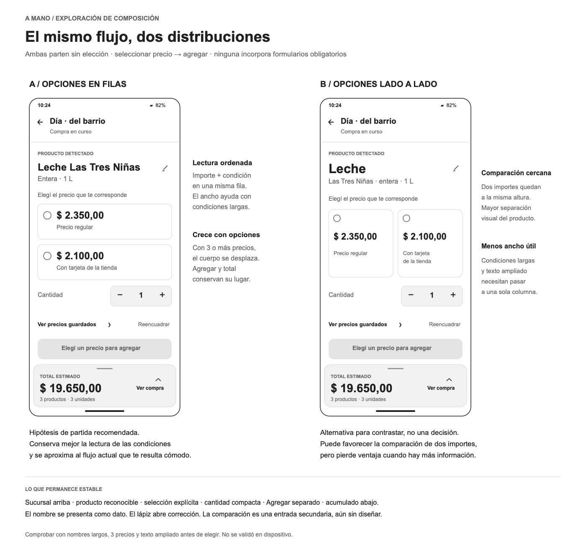

# Wireflow 01 · Compra activa

Fecha: 24 de septiembre de 2026.
Estado: **composición A de confirmación elegida por el usuario; resto del
recorrido en revisión, sin validación de uso en teléfono**.

Primera traducción a pantallas del [registro de decisiones](../../pantallas/README.md).
El desarrollo de acabado visual más reciente está en
[Dirección visual 01 · Lexend Deca](../../visual/v1/README.md); esta lámina
permanece como antecedente de estructura.
Son dibujos estáticos en escala de grises, no pantallas implementadas ni un
prototipo navegable. Las cantidades, precios y sucursal son ficticios.
Las dos láminas PNG son los únicos entregables visuales conservados de esta
ronda. Se retiraron las exportaciones SVG y pantallas individuales redundantes.
No se modificó el código de la aplicación.

## 1. Recorrido principal

| Estado | Qué ve la persona | Qué hace | Qué cambia |
| --- | --- | --- | --- |
| 01 · Captura | Cámara dominante, disparador y resumen con $19.650,00 | Captura una etiqueta | Tras leer, aparece el resultado; el total no cambia |
| 02 · Confirmación | Producto y opciones de precio | Elige regular, cambia cantidad a 2 y toca Agregar | Se incorporan 2 leches de $2.350,00; subtotal $4.700,00 |
| 03 · Agregado | Regresa al encuadre, feedback breve y total $24.350,00 | Captura otro producto o abre la compra | El carrito no se abre automáticamente |
| 04 · Compra completa | Lista de 4 productos, 5 unidades y total | Revisa, ajusta cantidades, edita o quita | El acumulado se recalcula; Atrás devuelve al encuadre |

El estado 02 de esta lámina muestra una elección **ya realizada**, no una
preselección automática entre varios precios. Las alternativas A/B muestran
el estado previo, sin selección. El paso 03 → 04 es opcional: se puede seguir
capturando. También se puede abrir la compra desde 01.

### Razón de las ubicaciones

- **Cabecera compacta:** identifica el local y permite volver. No consume el
  espacio principal con marca o explicaciones repetidas.
- **Cámara como centro de la tarea:** la guía concentra el encuadre; la etiqueta
  dibujada es un esquema para comunicar posición, no evidencia de OCR.
- **Disparador separado del carrito:** delimita dónde capturar y dónde tocar o
  deslizar para revisar. El ancho/alto finales se comprobarán en dispositivo.
- **Resumen inferior estable:** agrupa total, productos/unidades y Ver compra.
  Su animación lleva a una pantalla completa; no existe un carrito a media altura.
- **Confirmación sin foto permanente:** el centro pasa a mostrar producto y
  candidatos. Se mantiene el contexto mediante cabecera y resumen.
- **Agregar independiente:** elegir un precio no lo incorpora; el subtotal en
  la acción ayuda a anticipar el cambio sin reemplazar el total de la compra.
- **Feedback sin desplazar controles:** el último agregado ocupa una zona
  reservada encima del disparador, sin moverlo. Su duración y posible corrección
  directa se decidirán después. La información también debe anunciarse con
  tecnología asistiva, no depender de un mensaje fugaz.
- **Compra completa:** permite usar la superficie para revisar productos. El
  acceso a finalizar queda separado de las acciones de cada ítem.

## 2. Dos composiciones de confirmación

**Decisión posterior a la lámina: el usuario eligió A.** Las anotaciones de
recomendación en la imagen corresponden a la exploración previa a esa elección.

Ambas mantienen el mismo contenido y flujo. El único candidato se preselecciona
como en la app actual; con varios candidatos se espera una elección explícita.

| Criterio | A · Filas | B · Lado a lado |
| --- | --- | --- |
| Lectura del precio y su condición | Un bloque horizontal por opción | Dos importes próximos a la misma altura |
| Nombre del producto | Nombre completo seguido de presentación | Tipo de producto destacado, marca/presentación debajo |
| Condiciones largas | Más ancho para leer | Se fragmentan en más líneas |
| Tres o más precios | Mantener filas en un cuerpo desplazable | Requiere volver a una columna; no ocultar opciones en un carrusel |
| Texto ampliado | Crece la altura de filas | Se pierde la ventaja de las dos columnas |
| Hipótesis | Mejor punto de partida por claridad y continuidad con el flujo actual | Alternativa para comprobar si comparar dos importes resulta más directo |

**Composición elegida: A.** Su estructura es la base del siguiente diseño de
confirmación. La elección no equivale a una prueba de usabilidad. Quedan por
precisar el comportamiento de cantidad, corrección y errores, y el acabado visual.

## 3. Formato de las próximas entregas

Por preferencia del usuario, basta una lámina PNG del recorrido y, cuando haga
falta comparar opciones, una lámina PNG de alternativas. No generar versiones
individuales ni duplicar formatos. Los duplicados previos fueron retirados.
La documentación
explicativa sí continúa organizada por pantalla.

## 4. Comportamientos que el dibujo no resuelve por sí solo

### Contenido largo y desplazamiento

Los marcos usan 360 × 760 unidades lógicas como referencia de composición; no
representan una medición del Xiaomi ni sus píxeles físicos. La propuesta debe
adaptarse a otros tamaños, escala de texto, teclado y barras del sistema.

En confirmación se propone que el contenido central pueda desplazarse cuando
crezca; el área de Agregar y el resumen conservan su acceso mientras haya
espacio suficiente. Si texto ampliado o teclado dejan poco espacio, se debe
replantear la distribución; no reducir fuentes ni ocultar condiciones para que
encajen. Los dibujos sólo muestran el caso de dos precios y texto normal.

En la compra, la lista se desplaza y el resumen y cierre siguen accesibles.
El orden mostrado es último agregado primero, todavía **propuesto**. Con cuatro
productos todas las filas entran en esta composición; una compra de 30 productos
requiere comprobar desplazamiento, reubicación tras editar y estabilidad del total.

### Correcciones y quitar

El lápiz representa acceso a corregir; su forma final y la superficie de edición
siguen pendientes. Los pequeños íconos deben tener áreas táctiles amplias y
nombres accesibles. La papelera representa quitar; proponer un aviso con
Deshacer antes de decidir confirmaciones bloqueantes. No se dibujó aún ese estado.

En el ejemplo, retirar el arroz reduce $24.350,00 a $22.900,00; deshacer devuelve
el total anterior. Corregir el precio de ambas leches de $2.350,00 a $2.300,00
reduce el total inicial de $24.350,00 a $24.250,00. Son dos recorridos alternativos,
no acciones consecutivas. La posición y el mecanismo de edición deben diseñarse.

### Navegación

Atrás en compra vuelve a captura. No cerrar la compra al desplazar la lista.
El resumen del carrito se mantiene visible en confirmación para conservar la
referencia; abrirlo con una elección pendiente exige preservarla al regresar.
Ese comportamiento es una propuesta, no una resolución del punto abierto.

La transición ascendente del carrito es acordada; esta lámina estática no prueba
su animación, el gesto ni la compatibilidad con navegación Android.

### Fuera de esta lámina

Inicio, elección de sucursal, lectura fallida, cámara denegada, editor, detalle
de comparación, pendientes y finalización no tienen aquí una composición nueva.
El acceso a comparación marca su lugar propuesto, no una función implementada.
El cierre sigue requiriendo permitir un ticket opcional y completarlo después.
La carga manual permanece fuera del estado normal de captura; falta confirmar
su aparición como recuperación de errores.

## 5. Revisión conjunta

1. Mirar la captura: ¿se distingue dónde capturar y dónde revisar la compra?
2. Revisar A, ya elegida: ¿se entiende que elegir todavía no agrega? Comprobar
   lectura de condiciones largas y más de dos candidatos.
3. Volver al encuadre: ¿el feedback alcanza para reconocer las dos unidades y
   el nuevo total sin abrir el carrito?
4. Revisar compra: ¿nombre, cantidad y subtotal permiten decidir qué quitar?

Registrar las respuestas en los documentos de cada pantalla, manteniendo la
distinción entre acuerdo, preferencia declarada y resultado observado.

## 6. Comprobaciones de esta entrega

- Láminas PNG inspeccionadas visualmente: composición, textos y separación de
  controles. Se ajustaron controles de cantidad y acciones secundarias durante
  esa revisión. No equivale a una comprobación visual de la app en web.
- Enlaces locales y totales del ejemplo comprobados. Los dibujos conservan
  escala de grises y datos ficticios.
- No se ejecutaron pruebas del código ni se generaron bundles: esta entrega
  sólo añade documentación e imágenes estáticas.
- Gestos, animaciones, lectura con cámara, accesibilidad interactiva y ejecución
  en teléfono físico pendientes. No hay resultados de pruebas con participantes.
